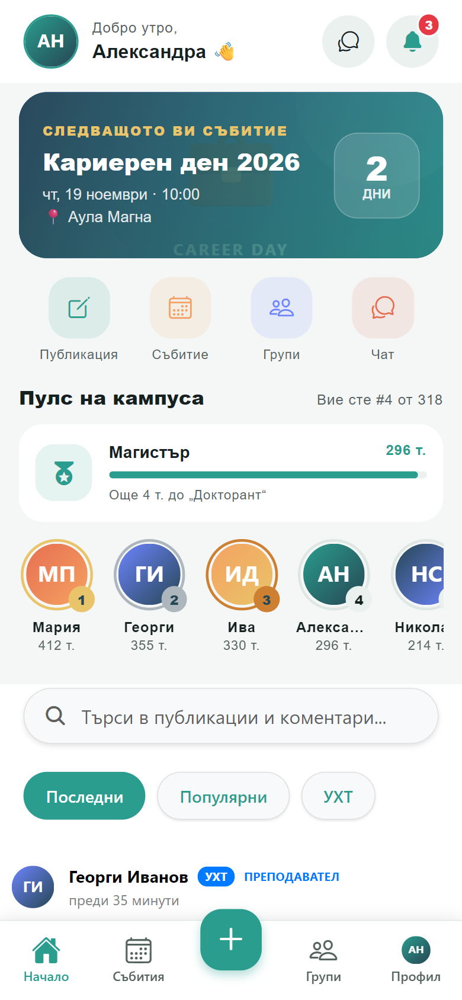
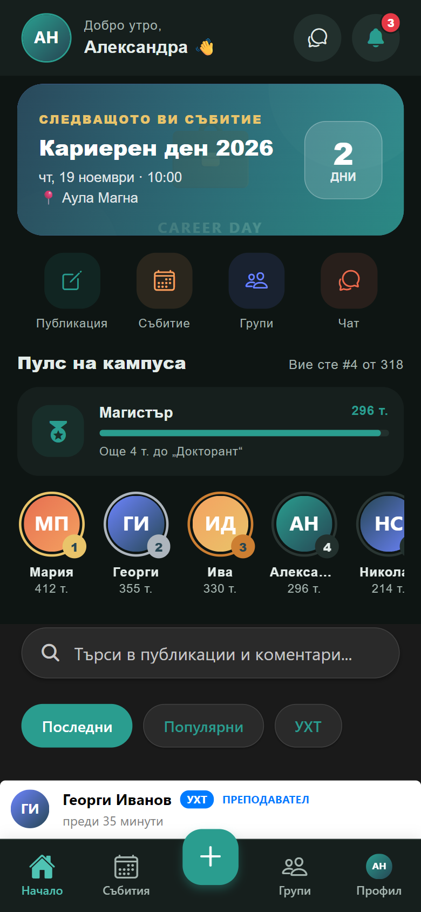

<div align="center">

# 🎓 AcademiX

### The social network of your university: events, groups, posts and chat in one app

[](https://reactnative.dev/)
[](https://expo.dev/)
[](https://www.typescriptlang.org/)
[](https://www.thenile.dev/)

_Master's thesis project: a cross-platform mobile app built for a Bulgarian university community (UI in Bulgarian)._

</div>

---

## Screenshots

| Home | Events | Event details | Notifications |
| :---: | :---: | :---: | :---: |
|  |  |  |  |

| Level & badges | Dark mode | Dark mode | Welcome |
| :---: | :---: | :---: | :---: |
|  |  |  |  |

<sub>Captured from the web build with demo data (no real users).</sub>

## What it does

| Area | Features |
| --- | --- |
| **Home** | Time-of-day greeting, a **"Next event" hero** with a live day countdown, quick actions, the **Campus Pulse** leaderboard and a feed with *Latest / Popular / Official (УХТ)* tabs |
| **Events** | Upcoming events sorted by date (past ones hidden), *My registrations*, *My events* and *Popular* tabs, search, register/interest, a countdown chip on each card (*Днес · 14:00*, *Утре*, *След 3 дни*), **Add to calendar (.ics with a 1h reminder)** and native sharing |
| **Notifications** | Comments on your posts, replies to your comments, new followers, new posts in your groups and **reminders 2 days before events you registered for**. Grouped by *Today / Yesterday / This week / Earlier*, with an unread badge on the bell |
| **Campus Pulse** | Activity points turn into **academic levels**: Първокурсник → Второкурсник → Бакалавър → Магистър → Докторант → Професор. Badges are unlocked by milestones. Shown on Home (top 10 + your rank) and on your profile (level card + badges) |
| **Groups** | Explore and follow clubs, club-only posts, owner moderation |
| **Posts** | Text, images and documents, likes, threaded comments with likes, role badges (Student / Teacher / Admin) |
| **Chat** | Real-time 1:1 and group chat on Firestore |
| **Profile & settings** | Avatar upload (Cloudinary), followers/following, **System / Light / Dark theme (remembered)**, contact info and a **secure password change through Firebase Auth** |

### Campus Pulse scoring

| Action | Points |
| --- | --- |
| Post | +10 |
| Event registration | +5 |
| Comment | +3 |
| Like received | +2 |
| Follower | +2 |

The weights live in [`utils/pulse.ts`](utils/pulse.ts). The API passes them to SQL as parameters, so the ranking and the UI can never disagree.

## Architecture

```
React Native (Expo Router) ──axios──▶ Expo API routes  app/(api)/*+api.tsx ──pg──▶ PostgreSQL (Nile)
        │                                                         
        ├── Firebase Auth   (sign-in, password)                   
        ├── Firestore       (chat rooms & messages, realtime)     
        └── Cloudinary      (image uploads)                       
```

- **Server state**: TanStack Query. Event mutations patch every cached list and the details entry in place (`useEventMutations`), so cards update without refetching.
- **Notifications** and **Campus Pulse** are computed from existing tables with SQL (`UNION ALL` / CTE + `RANK()`). There is no extra schema and no background jobs. The *unread* state is a per-user `lastSeen` timestamp in AsyncStorage.
- **Events filtering** happens server-side (`?filter=upcoming|registered|mine|popular`). Only the active tab fetches.
- **Theme**: a single Material 3 palette (deep teal + warm sand) for light and dark, applied through React Native Paper.

## Project structure

```
app/
  (api)/            REST endpoints: events, post, comment, user, clubs, notifications, pulse, ...
  (auth)/           SignIn, SignUp
  (tabs)/           Home, Event, AddPost, Club, Profile
  event/[id].tsx    event details
  notifications/    notifications center
  user-page/        public profiles
  chat/ settings/ add-event/ add-post/ add-club/ explore-clubs/
components/
  Home/             Header, CampusHero, LatestPost
  Pulse/            PulseStrip, LevelCard
  Events/ Post/ Clubs/ User/ Shared/
hooks/              useEvents, useNotifications, usePulse, usePosts, useComments, ...
utils/              eventDate (dates, countdown, ICS), eventActions (share/calendar), pulse, roles
context/            Auth, Theme, QueryClient
configs/            Firebase, Postgres pool, Cloudinary
```

## Getting started

```bash
npm install
npm start          # Expo dev server (LAN, port 8082)
npm run check      # TypeScript
npx jest utils --watchAll=false   # unit tests
```

Create a `.env` file in the project root:

```env
EXPO_PUBLIC_HOST_URL=http://<your-LAN-IP>:8082   # where the API routes are served
EXPO_PUBLIC_NILE_DB_USERNAME=...
EXPO_PUBLIC_NILE_DB_PASSWORD=...
EXPO_PUBLIC_CLOUDINARY_NAME=...
EXPO_PUBLIC_CLOUDINARY_API_KEY=...
EXPO_PUBLIC_CLOUDINARY_PRESET=...
```

## Database tables

`users`, `post`, `likes`, `comments`, `comment_likes`, `documents`, `clubs`, `clubfollowers`, `events`, `event_registration`, `event_interest`, `user_followers`

`events.event_date` is stored as `"<weekday>,YYYY-MM-DD"`. Server queries extract the ISO part with a regex, and so does `utils/eventDate.ts` on the client.

---

<div align="center">Built with React Native & Expo · © AcademiX</div>
