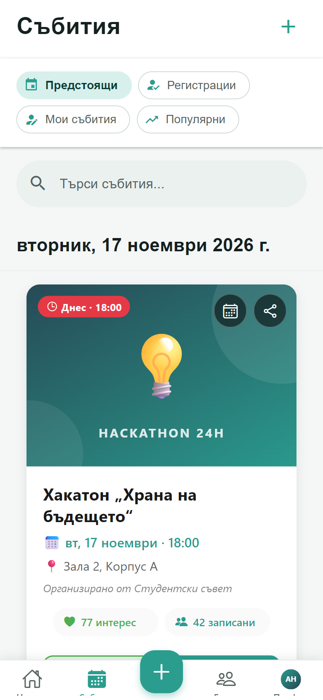
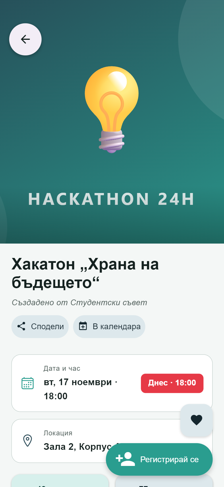
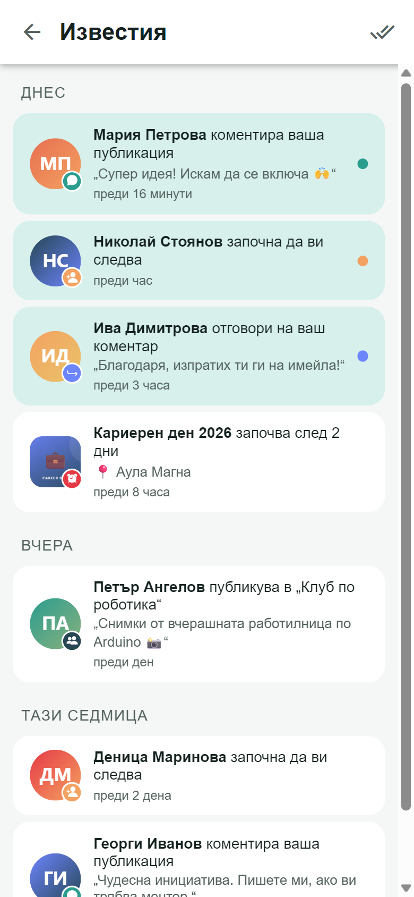
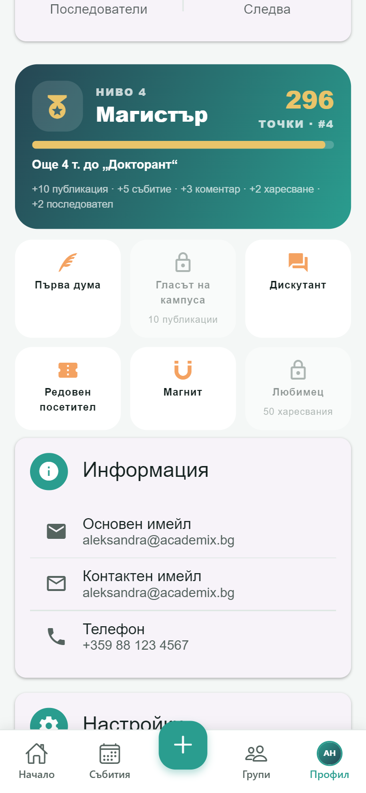
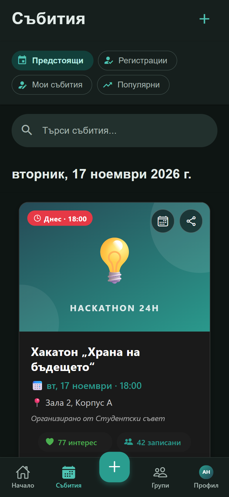
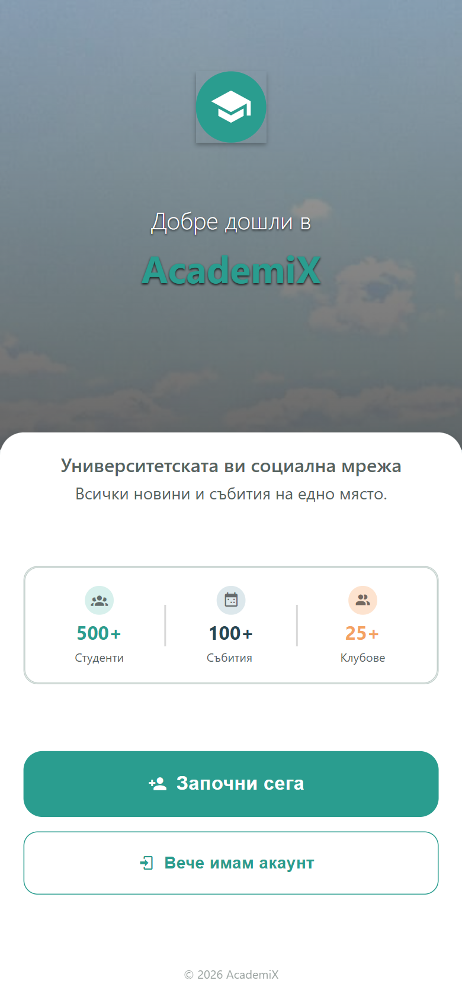

# AcademiX

A mobile app for university students: events, interest groups, posts and chat in one place. It's my master's thesis project. The interface is in Bulgarian.

It runs on iOS and Android with Expo. The same code also runs in the browser.

<p>
  
  
  
  
</p>
<p>
  
  
  
  
</p>

The screenshots come from the web build with made-up demo data.

## What you can do in it

- Browse upcoming events, register, and add them to your phone's calendar. Each card shows how soon the event starts.
- Get notified when someone comments on your post, replies to you or follows you, and two days before an event you signed up for.
- Join groups and post in them. Teachers and admins get their own badges, and official university (УХТ) posts get their own tab in the feed.
- Chat one-on-one or in groups.
- Earn points for being active. They move you up through study levels, from first-year student to professor. The home screen shows the top 10.
- Switch between light and dark theme.

## How it's built

The app is React Native with Expo Router and TypeScript. The backend consists of Expo API routes (`app/(api)`) that talk to PostgreSQL on Nile through `pg`. Firebase handles sign-in and the chat (Firestore), and images are stored on Cloudinary. TanStack Query caches the server data.

A few things worth looking at in the code:

- Notifications and the points leaderboard are computed with SQL from the existing tables (`app/(api)/user-notifications+api.tsx`, `app/(api)/pulse+api.tsx`). There's no extra table or background job to keep in sync.
- Event lists are filtered on the server, and each tab requests only what it shows.
- Registering for an event patches every cached list in place instead of refetching (`hooks/useEvents.ts`).
- The date, countdown and calendar-file logic lives in `utils/eventDate.ts` and has unit tests.

## Running it

```bash
npm install
npm start
```

It needs a `.env` file in the project root:

```env
EXPO_PUBLIC_HOST_URL=http://<your LAN IP>:8082
EXPO_PUBLIC_NILE_DB_USERNAME=
EXPO_PUBLIC_NILE_DB_PASSWORD=
EXPO_PUBLIC_CLOUDINARY_NAME=
EXPO_PUBLIC_CLOUDINARY_API_KEY=
EXPO_PUBLIC_CLOUDINARY_PRESET=
```

Run `npm run check` for the type check and `npx jest --watchAll=false` for the tests.

## Project layout

```
app/          screens (Expo Router), API routes in app/(api)
components/   UI, grouped by feature
hooks/        data fetching and mutations
utils/        dates, calendar export, points, roles
```
